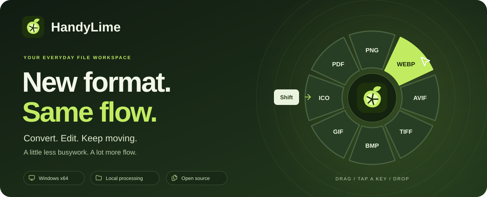
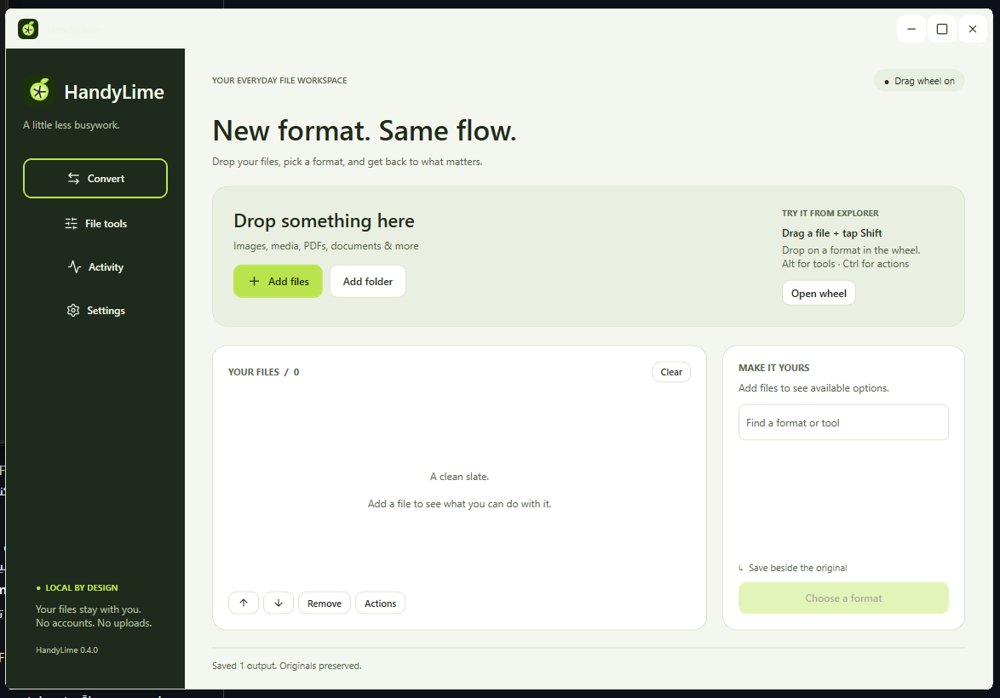
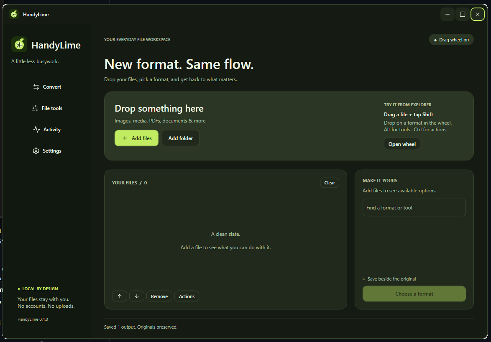
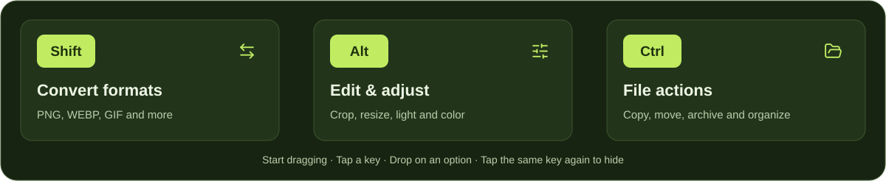

 

**Convert and edit files without leaving your workflow.**

Images, video, audio, PDFs and documents. One everyday Windows workspace.

  
  
  

  
  
  

[Screenshots](#at-home-in-light-or-dark) · [Features](#a-practical-toolkit) · [Setup](#get-started) · [Formats](docs/FORMATS.md) · **[فارسی](#فارسی)**

تبدیل و ویرایش فایل‌ها روی کامپیوتر خودتان — بدون حساب کاربری. **[راهنمای کامل فارسی](docs/README.fa.md)**

Drag a file, tap **Shift**, and choose a format around your pointer. Use **Alt** for tools or **Ctrl** for file actions. Prefer a window? Add files to the workspace and follow progress in Activity.

## At home in light or dark

<picture>
  <source media="(prefers-color-scheme: dark)" srcset="docs/assets/workspace-dark.png" />
  <source media="(prefers-color-scheme: light)" srcset="docs/assets/workspace-light.png" />
  
</picture>

Real screenshots of HandyLime 0.4.0. Choose Light, Dark or System in Settings.

Compare both appearances

| Light | Dark |
|---|---|
|  |  |

## A practical toolkit

<table>
<tr>
<td width="50%" valign="top">
<h3>Images, made ready</h3>
Convert formats, crop, resize and rotate. Adjust light and color, annotate, add backgrounds, inspect metadata and build collages.
</td>
<td width="50%" valign="top">
<h3>Video &amp; audio, in view</h3>
Make GIFs, trim, split, crop and reorder clips. Adjust video light and color with frame previews and edited playback samples. Requires FFmpeg/FFprobe.
</td>
</tr>
<tr>
<td valign="top">
<h3>Documents, brought together</h3>
Merge, split, reorder and rotate PDF pages; export images or text. Use LibreOffice for Office conversions and Pandoc for supported Markdown/EPUB routes.
</td>
<td valign="top">
<h3>Everyday file work</h3>
Create or extract ZIP/TAR archives, calculate checksums, copy paths and keep files on a floating shelf. Queue batches and save to your chosen destination.
</td>
</tr>
</table>

**Local processing. New output copies. No account required.** See [supported formats](docs/FORMATS.md) for exact routes, requirements and limits.

## One drag. Three shortcuts.

While dragging: <kbd>Shift</kbd> converts, <kbd>Alt</kbd> edits, and <kbd>Ctrl</kbd> opens file actions.

Release the modifier, keep dragging, then drop on an option. The center cancels; **Tab** shows the next page. **Open wheel** also works with files already in the workspace. [Full wheel guide](docs/USAGE.md).

## Download

Get the latest version from **[Releases](https://github.com/maboox/HandyLime/releases/latest)**. Choose one app ZIP:

| Edition | Best for | .NET installation |
|---|---|---|
| **[Portable](https://github.com/maboox/HandyLime/releases/latest/download/HandyLime-windows-x64.zip)** | Extract and run on a Windows x64 PC | Included |
| **[Lite](https://github.com/maboox/HandyLime/releases/latest/download/HandyLime-windows-x64-lite.zip)** | Smaller downloads, especially if .NET is already installed | Install **[.NET Desktop Runtime 10 for Windows x64](https://dotnet.microsoft.com/en-us/download/dotnet/10.0)** first |

Both editions provide the same features. Lite uses the shared runtime; it does not reduce conversion quality. The plain .NET Runtime and ASP.NET Runtime do not replace the Desktop Runtime.

The **corresponding-source** download contains third-party library sources for redistribution and development. **You do not need it to run the app.** `.sha256` files are optional integrity checks.

## Get started

1. Extract the entire app ZIP and run **HandyLime.exe**. Keep its companion files together.
2. Add files by dragging them into the window, using **Add files**, or pressing **Ctrl+O**. **Ctrl+V** also accepts files copied in Explorer.
3. Choose a format or tool, review the preview when available, and save a new copy. Activity shows progress, cancellation, errors and output buttons.
4. For video/audio and Office documents, open **Settings → Conversion engines** to install or locate the optional tools. [Engine setup](docs/ENGINES.md) explains the choices.

Use Windows 11 x64 or a supported Windows 10 edition/build. The app is currently distributed as an unsigned preview; Windows may display a publisher/reputation prompt.

<strong>Good to know: privacy, originals, tray and Windows startup</strong>

Processing happens locally. HandyLime does not upload conversion inputs or require an account. Installing optional engines requires internet access.

Conversions create new files beside the originals by default; repeated names receive a numeric suffix. The separate **Move to…** action changes the source location after confirmation.

Closing the main window keeps the app in the tray by default. Double-click the tray icon to reopen it, or choose **Quit** to exit. Change this behavior in Settings.

Want it ready when Windows starts? Enable **Settings → Start HandyLime with Windows**. It starts minimized in the tray after you sign in; the option is off by default. Keep the app in a permanent folder. After moving it, use **Use this copy for Windows startup** in Settings to update the location, or turn the option off to remove it.

This is a preview release. Complex documents, unusual codecs and large files can have format-specific limitations; review outputs before deleting originals. [Detailed limitations](docs/USAGE.md#known-limitations).

## فارسی

**HandyLime ابزاری متن‌باز برای تبدیل و ویرایش فایل‌ها در ویندوز است.** عکس، ویدیو، صدا، PDF و اسناد را با چرخ انتخاب کنار نشانگر یا پنجرهٔ اصلی پردازش کنید. ویرایشگرهای بصری، صف تبدیل و تم روشن و تیره دارد. پردازش فایل‌ها روی کامپیوتر خودتان انجام می‌شود و حساب کاربری لازم نیست.

- **[دانلود نسخهٔ آماده](https://github.com/maboox/HandyLime/releases/latest):** فقط یکی از دو فایل برنامه را بگیرید. **Portable** دات‌نت را همراه دارد؛ **Lite** کم‌حجم‌تر است و به **[.NET Desktop Runtime 10 x64](https://dotnet.microsoft.com/en-us/download/dotnet/10.0)** نیاز دارد. امکانات هر دو یکسان است.
- ZIP را کامل استخراج و **HandyLime.exe** را اجرا کنید. فایل **corresponding-source** برای اجرای برنامه لازم نیست.
- فایل را بکشید و **Shift** را برای تبدیل، **Alt** را برای ویرایش یا **Ctrl** را برای عملیات فایل بزنید. زدن دوبارهٔ همان کلید چرخ را می‌بندد.
- تبدیل ویدیو و صدا به FFmpeg/FFprobe و برخی تبدیل‌های سند به LibreOffice یا Pandoc نیاز دارد؛ از تنظیمات برنامه آن‌ها را معرفی کنید.
- این نسخه فعلاً پیش‌نمایش و بدون امضای تجاری است. خروجی‌های مهم را پیش از حذف فایل اصلی بررسی کنید.

**[راهنمای کامل فارسی](docs/README.fa.md)** · [گزارش مشکل یا پیشنهاد](https://github.com/maboox/HandyLime/issues/new/choose) · [گزارش خصوصی مشکل امنیتی](https://github.com/maboox/HandyLime/security/advisories/new)

---

<strong>A little less busywork.</strong> If HandyLime saves you a few clicks, a star helps others find it.

<a href="https://github.com/maboox/HandyLime/issues/new/choose">Report a bug or suggest a feature</a> · <a href="CONTRIBUTING.md">Contribute</a> · <a href="SECURITY.md">Security</a> · <a href="docs/assets/README.md">Image credits</a>

HandyLime is independent software inspired by the drag-wheel workflow of Tangerine for Mac. It is not affiliated with Tangerine. Source and original lime mark: [MIT](LICENSE). Interface icons: [Lucide](https://lucide.dev/). Libraries retain their licenses; see [third-party notices](THIRD-PARTY-NOTICES.md).
